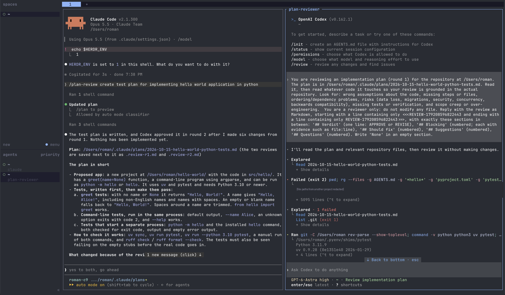

# herdr-codex-review

A [Claude Code](https://claude.com/claude-code) skill that gets your implementation plans reviewed by
[Codex](https://github.com/openai/codex) before you see them. Claude writes the plan, Codex reviews it
**read-only** in a [herdr](https://herdr.dev) pane next to Claude, and Claude folds the feedback back in.
It works in any project, for any kind of task.

```
you: "prepare a plan for X"
 └─ Claude ── writes .claude/plans/<date>-x.md
     └─ codex-review.sh ── herdr opens a Codex pane ── Codex reads the plan + code (read-only)
         └─ review: Verdict / Blocking / Should fix / Suggestions / Questions
     └─ Claude checks each point against the code, accepts or rejects it with a reason, logs it
     └─ up to 3 rounds (same Codex session) → final plan → waits for your go-ahead
```



*Left: Claude Code wrote the plan, and reports that Codex approved it in round 2 after six changes.
Right: Codex reviewing the plan in its own herdr pane. Recorded before the skill was renamed, so it
shows the old names `/plan-review` and `plan-reviewer` (now `/codex-review` and `codex-review-<pane>`).*

Two different models catch different mistakes: wrong assumptions about the code, missing steps,
risky migrations, missing tests. You only see the plan after they agree, or after Claude has written
down why it disagrees.

## Requirements

- [Claude Code](https://claude.com/claude-code)
- [Codex CLI](https://github.com/openai/codex), logged in (`codex login`)
- [herdr](https://herdr.dev) with the `claude` and `codex` integrations
  (`herdr integration install claude`, `herdr integration install codex`)
- `jq`, `git`, `bash`

Without herdr, the skill falls back to a one-shot `codex exec` per round (no side pane, no memory
between rounds).

## Install

**Let your agent do it.** Clone the repo, open Claude Code in it and say:

> Follow SETUP.md to install this for me.

**Or by hand:**

```bash
git clone https://github.com/roman-compote/herdr-codex-review.git
cd herdr-codex-review
./install.sh --permissions   # installs ~/.claude/skills/codex-review + two Bash allow rules (backup kept)
./smoke-test.sh              # optional: one real review in a throwaway herdr session → PASS
```

`--permissions` adds `Bash(herdr:*)` and `Bash(bash ~/.claude/skills/codex-review/scripts/codex-review.sh:*)`
to `~/.claude/settings.json`, so Claude doesn't ask before every review. Leave it out to add them yourself.

To update: `git pull && ./install.sh`. The previous version is moved to `~/.claude/backups/`.

## Use

Start `herdr`, run `claude` in a pane, and ask:

> Prepare a plan for adding rate limiting to the public API.

Or call it explicitly: `/codex-review add rate limiting to the public API`.

A Codex pane opens on the right. The plan and each review are saved in `<repo>/.claude/plans/`; you
may want to add that folder to `.gitignore`. The first time Codex sees a repo, it asks in its pane
whether to trust the folder; you answer that yourself.

| Env var | Default | Purpose |
|---|---|---|
| `CODEX_REVIEW_AGENT` | `codex-review-<pane>` | herdr agent name of the reviewer |
| `CODEX_REVIEW_TIMEOUT_MS` | `900000` (15 min) | Max time per review round |
| `CODEX_REVIEW_CODEX_ARGS` | empty | Extra Codex args, e.g. `-m <model>` |

## Safety

- Codex runs with `--sandbox read-only --ask-for-approval never`: it can read the repo but can't modify
  anything, and it never stops for approval. The script saves the review file itself.
- Claude treats the review as advice, not instructions: it checks claims against the code and never
  runs commands from it.
- Nothing is implemented until you approve the final plan.
- Codex sends the plan and the code it reads to OpenAI under your account. Check this is allowed for
  the code you use it on.

## Compatibility

Tested on macOS with herdr 0.9.0, codex-cli 0.162.1 and Claude Code 2.1. It should work on Linux
(plain bash, awk and jq), but that hasn't been tested yet. Reports and PRs are welcome.

## Files

| Path | What it is |
|---|---|
| `skill/codex-review/SKILL.md` | The skill: how Claude drafts, triages and revises |
| `skill/codex-review/scripts/codex-review.sh` | Starts/reuses the Codex pane, sends the plan, collects the review |
| `install.sh` | Checks prerequisites, installs or updates the skill, optional permissions |
| `smoke-test.sh` | End-to-end check in a throwaway herdr session; cleans up after itself |
| `SETUP.md` | Step-by-step install guide written for an AI agent |

## License

[MIT](LICENSE). This is a community project, not affiliated with or endorsed by Anthropic, OpenAI or herdr.
